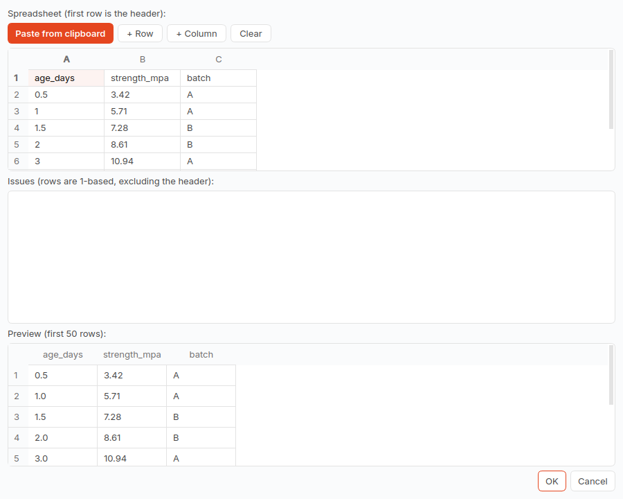
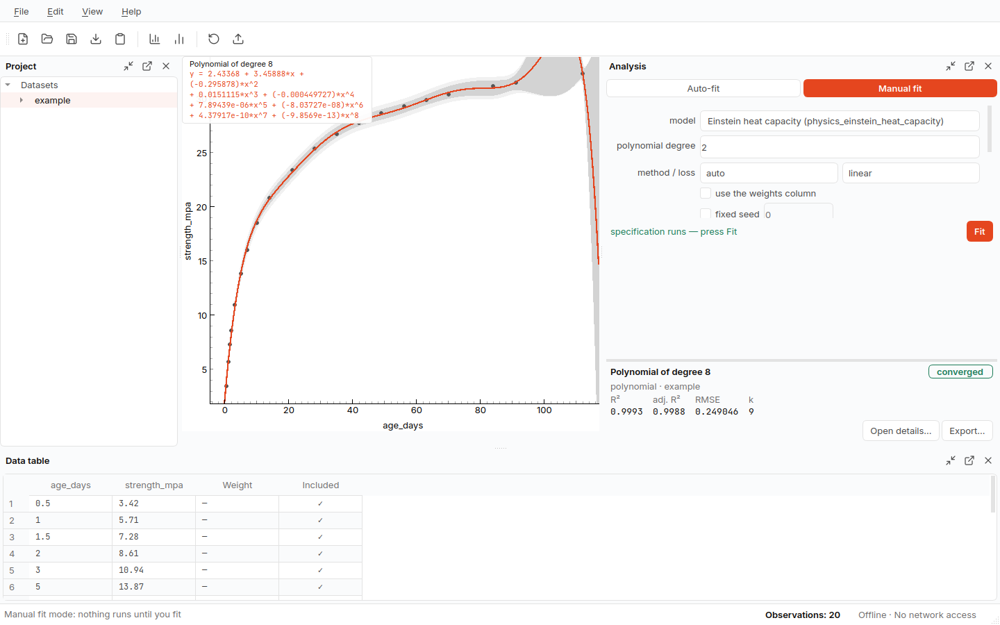

# CurveStudio — help content (canonical source)

Every fact below was read from the code, not invented. The desktop help browser and the web
`/help` page must render this text; only the markup differs. Do not add features that do not
exist, and do not describe a capability the code does not have.

---

## 1. Getting started

CurveStudio fits a curve to paired x/y measurements and tells you, honestly, how well it fits.
It is the same engine on the web and on the desktop, so a fit made in one matches the other.

1. **Open or create a project.** The desktop app starts with an empty project; the web app keeps
   your datasets under your account.
2. **Import your data** (CSV/TSV/TXT/JSON/XLSX, or paste from a spreadsheet).
3. **Let Auto-fit run** — it starts by itself after the first import. It screens the model
   library, fits the promising candidates and ranks them.
4. **Read the ranking.** The top row is the best fit by the chosen criterion. Select it to draw
   its curve and see its headline numbers; open its details for the full report.
5. **Export** the report, the ranking or the plot.

Three example datasets ship with the app: `example.csv` (age in days vs. compressive strength
in MPa), `example-decay.csv` (a first-order decay) and `example-kinetics.csv` (enzyme kinetics)
— good data to explore with.

## 2. Importing data

- **Accepted files:** `.csv`, `.tsv`, `.txt`, `.json`, `.xlsx`.
- **Spreadsheet grid:** *File → Import from clipboard* (Ctrl+Shift+V) opens an editable grid.
  Select the cells in Excel, LibreOffice Calc or Google Sheets, copy, click the grid and press
  Ctrl+V: the whole block lands in place (rows and columns grow to fit, a paste into an empty
  grid replaces it). Cells can be typed over, rows and columns added, and the first row is the
  header. Paste directly from the clipboard with the *Paste from clipboard* button, then check
  the preview and import.
- **Columns:** you map the columns after import. A dataset needs an **x**, a **y**, and
  optionally a **weight** column (blank means weight 1) and an **included** flag for excluding
  rows without deleting them.

- **Refused input:** x and y must be different columns; a file with fewer than three usable
  rows cannot be fitted, and the import says so rather than producing a curve from nothing.
- **Missing values:** a row whose x or y is empty, or not a number, is reported and skipped;
  nothing is guessed.

## 3. Auto-fit

Auto-fit is the default workflow: it fits many candidate models and ranks them, so you can see
whether a simpler model already explains the data.

**Options** (collapsed under *Options*):

| Option | Meaning |
|---|---|
| families (categories) | Comma-separated families to include; blank means all. |
| exhaustive | Also include the long tail of generated families — slower, rarely changes the top. |
| max parameters | Cap on free parameters per model; `auto` uses the engine's rule. |
| multi-starts | Number of starting points per nonlinear model (1–64). More starts cost time and reduce the chance that a fit lands on a poor optimum. |
| CV folds | K-fold cross-validation folds; `off` disables cross-validation. |
| seed | Seed for the deterministic subsampling and start generation. The same seed, data and options reproduce the same ranking. |

**What the ranking columns mean**

| Column | Meaning |
|---|---|
| Rank | Position by the active criterion (best first). |
| Model | Catalogue name. `✓` marks an exact fit, `⚠` a degenerate fit (a parameter at a bound, no effect on the curve), `≡` a model redundant with one ranked above it. |
| R² | Coefficient of determination. Higher is better, but it always rises with more parameters. |
| adj. R² | R² with the parameter count charged against it — the honest comparison. |
| RMSE | Residual standard error in y units. |
| k | Number of fitted parameters. |
| AICc / BIC | Information criteria (in the details report). Lower is better; both penalise parameters, AICc more strongly on small samples. |

- **Overfit and collinearity warnings** appear above the ranking; read them. A model that
  collapses onto a simpler one is ranked below it, not above.
- **Non-converged and skipped candidates** are listed in their own sections, never mixed into
  the ranking. "Not converged" means the optimiser could not satisfy its criteria; the model is
  not reported as a fit.
- **Cancel** stops a run; the partial rows that did converge are still usable, but the run is
  labelled partial and "Open full results" is disabled for it.
- **Order by** re-sorts the same ranking without refitting.

## 4. Manual fit and custom equations

Choose a model from the catalogue, or write an equation.

**Custom equation grammar**

- Variables: the dataset's x and y names, plus any parameter names you declare.
- Operators: `+ - * / **` and parentheses.
- Constants: `pi`, `E`.
- Unary functions: `exp`, `log` and `ln` (both natural log), `log10`, `sqrt`, `sin`, `cos`,
  `tan`, `sinh`, `cosh`, `tanh`, `asin`, `acos`, `atan`, `erf`, `erfc`, `Abs`/`abs`.
- Two-argument functions: `pow(base, exponent)`, `min(a, b)`, `max(a, b)`, `atan2(y, x)`.
- Three-argument function: `voigt(x, sigma, gamma)` — the area-normalised Voigt profile
  (`scipy.special.voigt_profile`).
- Limits: at most 300 expression nodes, 40 levels of nesting, and a constant exponent no
  larger than 1000. An expression that breaks these is refused with the reason.

**Notes**

- `log(x)` is the natural logarithm, not base 10 — write `log10(x)` for base 10.
- Every parameter gets an initial value and optional lower/upper bounds. A blank bound is
  unbounded; when both are given they must satisfy **lower < upper** (equal bounds are refused,
  as is an initial value outside them), so a parameter cannot be pinned as a hidden constant.
- An equation with no free parameter — one where every name is a variable, constant or function —
  is refused with a message saying there is nothing to fit.

## 5. Understanding the numbers

- **Parameter table:** estimate, standard error and 95% confidence interval. `n/a` means the fit
  could not determine the value (hovering the cell says so); it is never shown as zero.
- **Statistics tab:** fit statistics and the hypothesis tests the engine ran, each with a note
  saying what it tests.
- **Diagnostics tab:** residual plots and the checks that reveal a systematic misfit — a curve
  that passes through the middle of the residuals is doing less well than its R² suggests.
- **R² close to 1** is not proof of a good model: with many parameters it can be reached by
  fitting noise. Compare adj. R², AICc and the residual plots.

## 6. Prediction

The Predict tab evaluates the fitted model at x values you type or paste (comma, space or
newline separated) and can add a **confidence band** (the uncertainty of the mean response) or
a **prediction band** (the uncertainty of a single new observation, always wider). The number of
requested points is capped; past the cap the tab says so instead of silently truncating.

## 7. Projects (desktop)

A project holds its datasets, their fits and the Auto-fit results in one `.cstudio` file
(Ctrl+S saves, Ctrl+Shift+S saves a copy, Ctrl+O opens). Undo (Ctrl+Z) covers project edits.
A project saved on one machine opens on another; nothing is uploaded anywhere.

## 8. Exports

| What | Formats |
|---|---|
| Fit report | `.json`, `.xlsx`, `.pdf`, `.csv` (the CSV export writes the three result tables) |
| Auto-fit ranking | `.csv` |
| Plot | `.png`, `.svg`, `.pdf` |

CSV cells that begin with `=`, `+`, `-` or `@` are neutralised so a spreadsheet cannot execute
imported data as a formula.

## 9. Keyboard shortcuts (desktop)

| Action | Shortcut |
|---|---|
| New / Open / Save / Save as | Ctrl+N / Ctrl+O / Ctrl+S / Ctrl+Shift+S |
| Import data / Import from clipboard | Ctrl+I / Ctrl+Shift+V |
| Undo | Ctrl+Z |
| Reset view (fit the plot to the data) | Ctrl+R |
| Details (full result of the selected row or active fit) | Ctrl+D |
| Export plot | Ctrl+E |
| Help | F1 |
| Quit | Ctrl+Q |

Panels can be moved, floated, tabbed together, collapsed with the chevron in their title bar, or
closed. *View → Reset layout* restores the default arrangement.

## 10. Troubleshooting

- **"Not converged" for everything:** the data may be too sparse or too noisy for the requested
  models, or every start may have hit the time limit. Try fewer families, more multi-starts, or
  a simpler model.
- **The curve looks right but the fit is not ranked:** a non-converged fit is never ranked, even
  when its curve looks plausible. Read the details report for the termination reason.
- **Undefined statistics:** `n/a` means "the fit could not determine this", which is information,
  not an error.
- **The desktop app reports an unexpected error:** a dialog shows the traceback with a copy
  button. Saved project files are unaffected. Report it with the copied text.
- **No network (desktop):** the status bar says so. Fitting is local, so the app keeps working
  in full — there is no account and no upload.
- **Web:** fitting needs a connection to the server. The desktop app is the offline story.

## 11. About, licence, projects and policy

CurveStudio is built by **ConcreteInfo** — <https://www.concreteinfo.in> · amit@concreteinfo.in.
The About window and the About page list the other tools we build and maintain, in two groups —
open source (PC Power Calculator, Markdown Converter, GitHub Desktop for Linux) and commercial
software (ConcreteInfo Mix Design Platform, CAMS2) — explain why the desktop app is free and
AGPL, and carry the disclaimer and the privacy/fair-use policy in full. Three example datasets
ship with the app: `example.csv` (age against strength), `example-decay.csv` (first-order decay)
and `example-kinetics.csv` (enzyme kinetics), so no single discipline leads. In short:

- The desktop app is free software under AGPL-3.0-or-later; the web app is free today and may
  gain a small hosting subscription later (the desktop stays free).
- A fit describes agreement with *your* sample. It is not proof of a physical law, code
  compliance or safety — verify anything that matters against the standard and a second method.
- Desktop data stays on your machine. On the web your datasets and fits are stored in your
  account only to provide the service; deleting a dataset, a fit or your account removes them.

- CurveStudio: AGPL-3.0-or-later.
- Qt / PySide6 (desktop): LGPL-3.0.
- NumPy, SciPy, SymPy, pandas: BSD-3-Clause.
- pyqtgraph: MIT.
- Inter and JetBrains Mono typefaces: SIL Open Font License 1.1.
- Lucide icons: ISC.
- The model library follows the published forms of the equations it implements; the details
  report names the source for each family.

Version and source-code links are on the About page.
