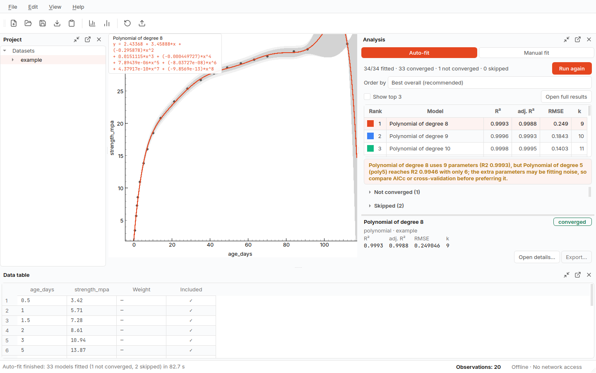
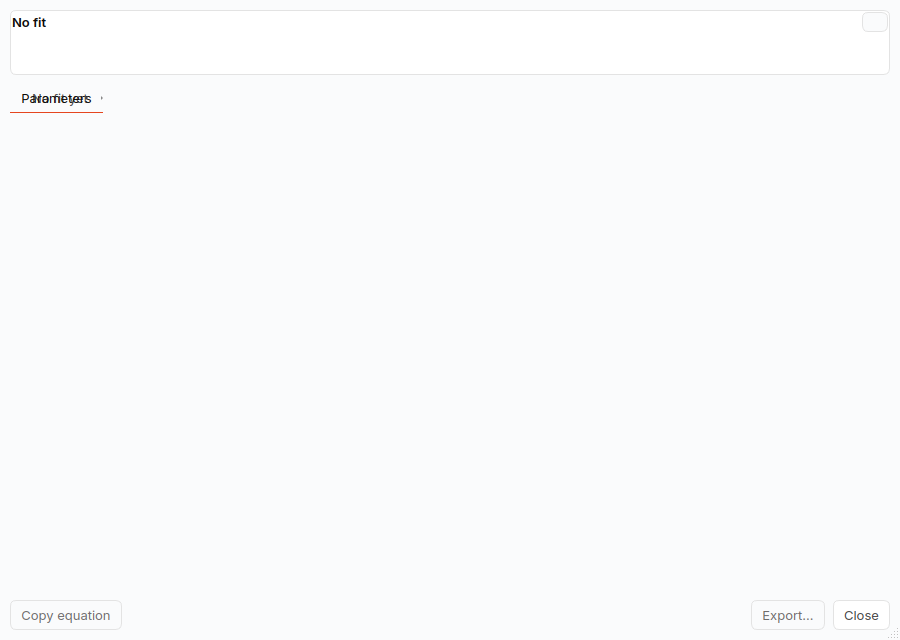

# CurveStudio — help content (canonical source)

Every fact below was read from the code, not invented. The desktop help browser and the web
`/help` page must render this text; only the markup differs. Do not add features that do not
exist, and do not describe a capability the code does not have.

---

## 1. Getting started

CurveStudio fits a curve to paired x/y measurements and tells you, honestly, how well it fits.
It is the same engine on the web and on the desktop, so a fit made in one matches the other.

1. **Open or create a project.** The desktop app starts with an empty project; the web app keeps
   your datasets under your account.
2. **Import your data** (CSV/TSV/TXT/JSON/XLSX, or paste from a spreadsheet).
3. **Let Auto-fit run** — it starts by itself after the first import. It screens the model
   library, fits the promising candidates and ranks them.
4. **Read the ranking.** The top row is the best fit by the chosen criterion. Select it to draw
   its curve and see its headline numbers; open its details for the full report.
5. **Export** the report, the ranking or the plot.

Three example datasets ship with the app: `example.csv` (age in days vs. compressive strength
in MPa), `example-decay.csv` (a first-order decay) and `example-kinetics.csv` (enzyme kinetics)
— good data to explore with.

## 2. Importing data

- **Accepted files:** `.csv`, `.tsv`, `.txt`, `.json`, `.xlsx`.
- **Spreadsheet grid:** *File → Import from clipboard* (Ctrl+Shift+V) opens an editable grid.
  Select the cells in Excel, LibreOffice Calc or Google Sheets, copy, click the grid and press
  Ctrl+V: the whole block lands in place (rows and columns grow to fit, a paste into an empty
  grid replaces it). Cells can be typed over, rows and columns added, and the first row is the
  header. Paste directly from the clipboard with the *Paste from clipboard* button, then check
  the preview and import.
- **Columns:** you map the columns after import. A dataset needs an **x**, a **y**, and
  optionally a **weight** column (blank means weight 1) and an **included** flag for excluding
  rows without deleting them.

- **Refused input:** x and y must be different columns; a file with fewer than three usable
  rows cannot be fitted, and the import says so rather than producing a curve from nothing.
- **Missing values:** a row whose x or y is empty, or not a number, is reported and skipped;
  nothing is guessed.

## 3. Auto-fit

Auto-fit is the default workflow: it fits many candidate models and ranks them, so you can see
whether a simpler model already explains the data.

**Options** (collapsed under *Options*):

| Option | Meaning |
|---|---|
| families (categories) | Comma-separated families to include; blank means all. |
| exhaustive | Also include the long tail of generated families — slower, rarely changes the top. |
| max parameters | Cap on free parameters per model; `auto` uses the engine's rule. |
| multi-starts | Number of starting points per nonlinear model (1–64). More starts cost time and reduce the chance that a fit lands on a poor optimum. |
| CV folds | K-fold cross-validation folds; `off` disables cross-validation. |
| seed | Seed for the deterministic subsampling and start generation. The same seed, data and options reproduce the same ranking. |

**What the ranking columns mean**

| Column | Meaning |
|---|---|
| Rank | Position by the active criterion (best first). |
| Model | Catalogue name. `✓` marks an exact fit, `⚠` a degenerate fit (a parameter at a bound, no effect on the curve), `≡` a model redundant with one ranked above it. |
| R² | Coefficient of determination. Higher is better, but it always rises with more parameters. |
| adj. R² | R² with the parameter count charged against it — the honest comparison. |
| RMSE | Residual standard error in y units. |
| k | Number of fitted parameters. |
| AICc / BIC | Information criteria (in the details report). Lower is better; both penalise parameters, AICc more strongly on small samples. |

- **Overfit and collinearity warnings** appear above the ranking; read them. A model that
  collapses onto a simpler one is ranked below it, not above.
- **Non-converged and skipped candidates** are listed in their own sections, never mixed into
  the ranking. "Not converged" means the optimiser could not satisfy its criteria; the model is
  not reported as a fit.
- **Cancel** stops a run; the partial rows that did converge are still usable, but the run is
  labelled partial and "Open full results" is disabled for it.
- **Order by** re-sorts the same ranking without refitting.

## 4. Manual fit and custom equations

Choose a model from the catalogue, or write an equation.

**Custom equation grammar**

- Variables: the dataset's x and y names, plus any parameter names you declare.
- Operators: `+ - * / **` and parentheses.
- Constants: `pi`, `E`.
- Unary functions: `exp`, `log` and `ln` (both natural log), `log10`, `sqrt`, `sin`, `cos`,
  `tan`, `sinh`, `cosh`, `tanh`, `asin`, `acos`, `atan`, `erf`, `erfc`, `Abs`/`abs`.
- Two-argument functions: `pow(base, exponent)`, `min(a, b)`, `max(a, b)`, `atan2(y, x)`.
- Three-argument function: `voigt(x, sigma, gamma)` — the area-normalised Voigt profile
  (`scipy.special.voigt_profile`).
- Limits: at most 300 expression nodes, 40 levels of nesting, and a constant exponent no
  larger than 1000. An expression that breaks these is refused with the reason.

**Notes**

- `log(x)` is the natural logarithm, not base 10 — write `log10(x)` for base 10.
- Every parameter gets an initial value and optional lower/upper bounds. A blank bound is
  unbounded; when both are given they must satisfy **lower < upper** (equal bounds are refused,
  as is an initial value outside them), so a parameter cannot be pinned as a hidden constant.
- An equation with no free parameter — one where every name is a variable, constant or function —
  is refused with a message saying there is nothing to fit.

## 5. Understanding the numbers

- **Parameter table:** estimate, standard error and 95% confidence interval. `n/a` means the fit
  could not determine the value (hovering the cell says so); it is never shown as zero.
- **Statistics tab:** fit statistics and the hypothesis tests the engine ran, each with a note
  saying what it tests.
- **Diagnostics tab:** residual plots and the checks that reveal a systematic misfit — a curve
  that passes through the middle of the residuals is doing less well than its R² suggests.
- **R² close to 1** is not proof of a good model: with many parameters it can be reached by
  fitting noise. Compare adj. R², AICc and the residual plots.

## 6. Prediction

The Predict tab evaluates the fitted model at x values you type or paste (comma, space or
newline separated) and can add a **confidence band** (the uncertainty of the mean response) or
a **prediction band** (the uncertainty of a single new observation, always wider). The number of
requested points is capped; past the cap the tab says so instead of silently truncating.

## 7. Projects (desktop)

A project holds its datasets, their fits and the Auto-fit results in one `.cstudio` file
(Ctrl+S saves, Ctrl+Shift+S saves a copy, Ctrl+O opens). Undo (Ctrl+Z) covers project edits.
A project saved on one machine opens on another: it is a file on your computer, never uploaded.

## 8. Exports

| What | Formats |
|---|---|
| Fit report | `.json`, `.xlsx`, `.pdf`, `.csv` (the CSV export writes the three result tables) |
| Auto-fit ranking | `.csv` |
| Plot | `.png`, `.svg`, `.pdf` |

CSV cells that begin with `=`, `+`, `-` or `@` are neutralised so a spreadsheet cannot execute
imported data as a formula.

## 9. Keyboard shortcuts (desktop)

| Action | Shortcut |
|---|---|
| New / Open / Save / Save as | Ctrl+N / Ctrl+O / Ctrl+S / Ctrl+Shift+S |
| Import data / Import from clipboard | Ctrl+I / Ctrl+Shift+V |
| Undo | Ctrl+Z |
| Preferences… (report byline and theme) | Ctrl+, |
| Reset view (fit the plot to the data) | Ctrl+R |
| Details (full result of the selected row or active fit) | Ctrl+D |
| Export plot | Ctrl+E |
| Help | F1 |
| Quit | Ctrl+Q |

Panels can be moved, floated, tabbed together, collapsed with the chevron in their title bar, or
closed. *View → Reset layout* restores the default arrangement.

## 10. Troubleshooting

- **"Not converged" for everything:** the data may be too sparse or too noisy for the requested
  models, or every start may have hit the time limit. Try fewer families, more multi-starts, or
  a simpler model.
- **The curve looks right but the fit is not ranked:** a non-converged fit is never ranked, even
  when its curve looks plausible. Read the details report for the termination reason.
- **Undefined statistics:** `n/a` means "the fit could not determine this", which is information,
  not an error.
- **The desktop app reports an unexpected error:** a dialog shows the traceback with a copy
  button, and the same report is kept in a `crash.log` on your computer (its "Open log
  folder" button leads there); nothing is sent. Saved project files are unaffected.
  Report it with the copied text.
- **No network (desktop):** fitting is local, so the app keeps working in full, with no
  account. The only thing it sends is one anonymous install record (version, operating
  system, package type), on first launch and after an upgrade; without a connection it
  waits for a later launch, and Edit → Preferences → Privacy turns it off.
- **Web:** fitting needs a connection to the server. The desktop app is the offline story.

## 11. Fit audit and methods text

After a fit, the **fit audit** checks the evidence for it, check by check, and says what to do
next. On the desktop it is the **Fit audit** tab of a fit's results, after Diagnostics; on the
web it is the **Fit audit** tab; from the command line, `curvestudio audit` fits a curve and
prints the same checks.

At the top sit the overall verdict (**Pass**, **Caution**, **Fail** or **Not applicable**), a
summary in one to three sentences, the counts (`40 observations, 3 parameters`) and any rows
that took no part, with the reason. Then comes one block per check: its verdict, its evidence,
its statistic and the threshold it was judged by, what the check is about, and the next step
when there is one. A fit that did not converge fails the first check, and every other check
reads Not applicable.

| Check | If it is flagged |
|---|---|
| The fit converged | Check the starting values and the bounds, or try a model with fewer parameters. |
| The model does not pass through every point | There is no scatter to estimate uncertainty from, so report no intervals or p-values for this fit. |
| Residuals are consistent with a normal distribution (Shapiro–Wilk) | If a few points cause it, try a robust loss (Huber or soft-L1). Otherwise say in your write-up that the intervals rely on an approximation. |
| Residuals show no autocorrelation in x order (Durbin–Watson) | Plot the residuals against x in data order. If they wander, the model is missing a shape; if they alternate, look at how the data were taken. |
| Residual variance is consistent with being constant (Breusch–Pagan) | If the spread grows with the signal, use weights from replicates or a robust loss, and say so. |
| No single point has a large influence on the fit (Cook's distance) | Refit without the point and compare the estimates. If the conclusions differ, report both fits or justify leaving the point out. Do not delete data to improve a fit. |
| Residuals show no trend in x | The residuals show a curved trend, so the model is missing a shape the data contain. Try a model with one more parameter. |
| No parameter sits at a bound or is poorly determined | A parameter at a bound or with a wide interval is not pinned down by these data. Fix the bound if it is wrong, take more points where the model is sensitive, or use a model with fewer parameters. |
| There are at least 10 points per parameter | Take more points, or use a simpler model. |
| Held-out error is close to what a correct model shows (cross-validation) | The fit describes noise as well as signal. A simpler model, or one with fewer parameters, will predict better. |
| No simpler model fits as well (from an Auto-fit ranking) | Report the simpler model unless the extra parameter answers a question of your own. |

The first column is how a check reads when it passes; the second is the audit's own next step.
Three of the checks are read by more than a p-value. The autocorrelation check is decided by
Durbin–Watson p-values that are exact for the fitted model and computed for at most 1,000
points: Ljung–Box is reported beside them and does not change the verdict, and where they are
not computed it decides alone; with repeated x values the test is approximate. Cook's distance
is set against the fit's own confidence region — a caution when one point's removal would move
the estimates outside the 90 % region, a failure when outside the 99 % — and more points than
chance crossing the 4/n line flag it too. A simpler model is one within 2 AICc of the best
that is neither degenerate nor redundant.

**Reading a verdict.** A verdict is evidence, not proof. **Pass**: nothing in the data
contradicts the assumption at the conventional level. **Caution**: for the statistical tests,
evidence that would turn up by chance in 1 fit in 20 or fewer if the assumption held. **Fail**:
for them, evidence that would turn up in 1 fit in 1,000 or fewer. For the rule-based checks — a
parameter at a bound, fewer than 5 points per parameter, a point whose removal leaves the 99 %
confidence region, a held-out error far above what a correct model shows — a failure means the
rule was met outright. **Not applicable**: the check could not be made, and the block says why.
The four residual tests work at the 5 % level, so on data that meet every assumption about one
fit in twenty still shows a caution on a given test; a single caution is a prompt to look, not
a verdict on the analysis.

**Cross-validation.** A stored fit does not carry its held-out error, so that check reads Not
applicable until you run it. A control at the end of the tab runs 5, 10 or leave-one-out folds
as a job you can cancel: a background job on the desktop, where the result is not saved with
the project; on the web a job that uses none of your quota, whose result is kept with the fit.
Leave-one-out refits once per point, so it runs on at most 2,000 points. A fit that did not
converge cannot be cross-validated, and the control says so. On the command line,
`curvestudio audit --cv 5` (or `--cv loo`) adds it, and `--ranking` lets the simpler-model
check run.

**The methods text.** It writes the fit up for a paper. Its paragraph names the model, the
estimator, the observations used and those left out, and any bounds, and cites the software
with its version and address; the equation gives each estimate with its standard error; the
table adds 95 % confidence intervals. **Copy methods text** (desktop: the details window's
footer and the Equation tab) and **Copy methods** (web) put the three on the clipboard as plain
text, Markdown or LaTeX; the LaTeX table needs the `booktabs` package and the equation
`amsmath`. `curvestudio methods --style markdown` (or `text` or `latex`) prints them with the
model's references, the three things only the author can write — the instrument and
measurement method, how the sample size was chosen, how the data were cleaned — and whatever
the fit did not record. Nothing is guessed, and there is no DOI to cite yet.

The audit is a screen for the common ways a fit misleads; it does not replace looking at the
residuals and knowing the measurement.

## 12. Statistics tools

The **Statistics page** on the desktop and the **Statistics mode** on the web run the same
nineteen tools, in seven families, on a dataset's columns. Pick a tool from the catalogue,
choose the dataset it reads, fill in its fields and press **Run**; the command line runs the
same tools with `curvestudio stats --list` and `curvestudio stats <tool> <file> …`.

Each field is one of four kinds: a **numeric column**, **several columns** (one to twenty,
depending on the tool), a **group column** whose levels are the groups compared, or an
**option** (a confidence level, a post-hoc test, a number of bins, a flag). The description
under each field says what it expects. A required field left empty stops the run with its
reason rather than guessing a column.

**What a result holds.** Every tool returns the same shape of result, and the desktop and web
apps show it in the same order:

- **Estimates** — a label, the value, its standard error and the interval the level names.
- **Tests** — the test's name, its statistic, its degrees of freedom, its p-value and, where
  several comparisons were made, the adjusted p-value.
- **Assumptions** — one card per check the tool could make: what was read, the statistic, the
  rule it was judged by, and what to do when it is flagged.
- **Warnings** — anything the data forced, such as a column that does not vary.
- **Tables and plots** — the extra tables and pictures the tool draws.
- **Interpretation** — one to three plain sentences on what the result says.
- **Methods** — a paragraph that can be carried into a paper as it stands; copy it with
  **Copy methods text** on the desktop and on the web.
- **Counts and excluded rows** — how many rows were offered, used and excluded, with each
  excluded row's position and the reason it was left out (the web lists it under **Rows**).
  Nothing is dropped without being counted.

**Reading a verdict.** The assumption cards use four words. **Pass**: nothing in the data
contradicts the assumption at the usual level. **Caution**: evidence that would turn up by
chance in about 1 such check in 20 if the assumption held. **Fail**: evidence that would turn
up in about 1 in 1,000. **Not applicable**: the check could not be made, and the card says
why. A verdict is evidence, not proof: a caution is a prompt to look, and a pass does not
prove the assumption holds. The same reading applies to every p-value: a small one is evidence
against the null hypothesis, and a large one is not evidence that the null is true.

Points outside **Tukey's fences** are flagged in their own table and kept in every statistic:
a summary describes the data it was given and does not decide which points to believe. No tool
removes a point for being unusual.

## 13. Summarising columns

The **Summarise** family describes one column: where its values sit and how far they spread.
Both tools read a single numeric column, and the rows the column cannot use are counted and
listed.

### Descriptive statistics

Reads one column, optionally split by a group column. It reports the mean, the sample
standard deviation, the quartiles, the coefficient of variation, the bias-corrected skewness
and the excess kurtosis, and a t interval around each mean. A group column summarises each of
its levels separately. Points beyond Tukey's fences (1.5 interquartile ranges past the
quartiles) appear in their own table and are kept in every number above: the summary describes
the data it was given. The methods fragment writes each definition once.

### Distribution analysis

Reads one column and reports its mean with an interval and its standard deviation, then tests
whether the values look normal with the Shapiro–Wilk and Anderson–Darling tests. A histogram
with the fitted normal's expected count in each bin and a normal Q-Q plot show the shape the
tests are reading; leave **Bins** empty and the Freedman–Diaconis rule picks the number. A
small p-value is evidence that the values are not normal; a large one is not evidence that
they are.

## 14. Comparing means

The **Compare means** family asks whether groups share a mean, by the t test and the analysis
of variance. Every test reports the difference or the effect size with an interval beside its
p-value, and every assumption the data can show is checked.

### t tests

One tool with three kinds. **one_sample** tests a column's mean against the hypothesised
value. **independent** compares two groups' means, given either two columns or one column and
a group column with exactly two levels; Welch's test is the default and **Equal variances**
switches to Student's test. **paired** compares the difference of two columns, or one column
of differences, against the hypothesised difference. Each reports Hedges' g (Cohen's dz for
the paired test) with its interval. Shapiro–Wilk checks normality, Levene's median-centred
test checks equal variances under Student's test, and the paired test checks that every pair
is complete.

### One-way analysis of variance

Compares the mean of one column across the levels of a group column, and reports eta squared
and omega squared for how much of the variation the groups account for. With more than two
groups a post-hoc test follows: **Tukey** compares every pair, and **Dunnett** compares every
group against the **Control** level; each p-value is already adjusted for the family. Welch's
analysis of variance, which does not assume equal variances, is reported beside the ordinary
one. Shapiro–Wilk checks each group's normality and Levene's test their equal variances.

### Two-way analysis of variance

Splits a column's mean by two group columns and their interaction, and reports the main
effects, the interaction and partial eta squared. An unbalanced design is read by Type II
sums of squares, so the order the factors are given in does not change the table.

### Repeated-measures analysis of variance

Compares the same subjects measured under two to twenty conditions, given one column per
condition in wide form and optional condition **Names**. A row missing in any condition is
left out of all of them. The F test assumes sphericity — that the conditions are equally
correlated — so Mauchly's test checks it, and the Greenhouse–Geisser and Huynh–Feldt
corrections scale the degrees of freedom when it is doubtful. Generalised eta squared is the
effect size.

## 15. Rank-based comparisons

The **Rank-based comparisons** family reads the order of the values, never their size, so an
outlier moves a rank no further than the next value would. None of them assumes the values
are normally distributed; each reports an effect size or an interval beside its p-value. It
holds the two-sample, paired and several-group comparisons.

### Mann-Whitney U test

Compares two independent samples, given as two columns or as one column split by a group
column with exactly two levels. It reports the Hodges–Lehmann shift with a distribution-free
interval and the rank-biserial correlation. It answers whether one sample tends to be larger,
not whether the means are equal.

### Wilcoxon signed-rank test

Compares paired differences against the **Null value**: give two columns, or one column of
differences. Zero differences are left out, as Wilcoxon's original rule does. It reports the
pseudo-median — the median of the Walsh averages — with its interval and the matched-pairs
rank-biserial correlation.

### Sign test

Counts how many differences fall above and below the **Null value** and tests that count. It
asks only that the differences mostly fall on one side, so it is used when their sizes are not
trustworthy and only their direction is. It reports the median with the interval the sign test
itself gives.

### Kruskal–Wallis test

Compares the groups' mean ranks across the levels of a group column, gives tied values their
average rank, and corrects for the ties. Dunn's test compares the pairs when there are more
than two groups, with Holm's method adjusting its p-values. It makes no assumption of
normality.

### Friedman test

The rank-based counterpart of the repeated-measures analysis: it ranks each subject's
conditions together and asks whether the mean ranks differ, with Kendall's W as its effect
size. Durbin–Conover comparisons follow when there are more than two conditions, with Holm's
method adjusting them. It needs at least three conditions.

None of these tests whether the groups share a shape; read the box plot for that. A small
p-value is evidence that they differ in their typical value, and it does not prove by how
much or why.

## 16. Relationships between columns

The **Relationships between columns** family asks whether one column moves with another: the
correlation coefficient for a pair, and a regression line for a model.

### Correlation

Takes two to twenty numeric columns and reports the coefficient between every pair, on the
rows complete in both of that pair. **Pearson** measures a linear association; **Spearman**
measures a monotone one and uses the t approximation; **Kendall** reports tau-b with the
normal approximation. Each pair gets a test and an interval, and the whole matrix is shown
with 1 on its diagonal. A pair with fewer than three complete rows, or with a column that
does not vary, has no coefficient: the result says why and warns rather than showing a
number. Scatter plots are drawn when there are at most four pairs. A strong curved
relationship can read near 0, so a scatter plot is the first thing to read.

### Linear regression

Explains one **Outcome** column from one to twenty **Predictors** by ordinary least squares.
It reports each coefficient with its standard error, t statistic, p-value and interval, the
standardised coefficients, each predictor's variance inflation factor, and prediction
intervals at predictor values you give (up to 1,000 rows). One predictor is drawn as a
scatter plot with the fitted line and the confidence band of the mean response; the residuals
against the fitted values and a normal Q-Q plot of the residuals are always drawn.
Shapiro–Wilk checks the residuals' normality, the studentized Breusch–Pagan test a constant
variance, and the exact Durbin–Watson test independence in the order of the rows. Linearity is
not one number: read the residuals against each predictor. A predictor that does not vary, or
that is exactly collinear with the others, is refused, and so is a model with fewer than one
residual degree of freedom.

## 17. Counts

The **Counts** family tabulates two label columns and tests whether they are associated.

### Contingency table

Pairs a **Rows** label with a **Columns** label by row position and counts every combination.
It reports the Pearson chi-square test of independence, Cramér's V as the effect size, and
for a 2 x 2 table the odds ratio and the risk ratio with their intervals. The exact test
replaces the chi-square test for a 2 x 2 table whose smallest expected count is below 5. Four
tables show the counts, the row percentages, the column percentages and each cell's share of
the total. A row without a label in either column is left out and listed.

### McNemar's test

Reads the same subjects' two-level labels **Before** and **After** a change, paired by row
position, and tests whether the two marginal proportions are equal. It uses the exact
binomial distribution when the discordant pairs number at most 25, and the chi-square
distribution with a continuity correction otherwise. The effect is the difference in the two
marginal proportions, with Newcombe's method 10 interval for paired proportions. A level that
the paired rows leave empty is dropped with a warning.

A small p-value is evidence of an association (or of a change), not proof of its cause, and a
large one is not evidence that the columns are independent.

## 18. Comparing two methods

The **Method comparison** family asks whether two methods that measure the same quantity agree
closely enough to be used interchangeably. All three tools pair **Method A**'s readings with
**Method B**'s by row position on the rows complete in both, and count and list every row
left out.

### Bland–Altman agreement

Takes the difference of each pair (method A minus method B) against the pair's mean, and
reports the bias, the standard deviation of the differences and the limits of agreement at
the bias plus or minus 1.96 standard deviations, each with an interval at the chosen level;
the limits themselves stay at 95 %. Points beyond the
limits are listed, never removed: they are where the methods disagree most. A slope away from
zero in the regression of the difference on the mean is proportional bias — the difference
changes with the size of the reading. Shapiro–Wilk checks the differences' normality and the
studentized Breusch–Pagan test a constant variance. The difference-against-mean plot carries
the bias, both limits and zero; a second plot puts method A against method B with the line of
equality.

### Deming regression

Fits the line relating method B to method A while allowing for measurement error in both,
weighted by the **Error ratio** of their error variances. One means both methods carry the
same error variance; a larger value means method B is the noisier one. That ratio is an
assumption the fit makes, not a quantity these data estimate, and the result says so. The
standard errors come from the delete-one jackknife.

### Passing–Bablok regression

Fits the same line with no assumption about the distribution of the errors: the slope is the
shifted median of the slopes between every pair of points, and the intercept the median of
the intercepts through that slope. Its intervals are the rank-based intervals of Passing and
Bablok. A straight-line relation is still assumed, and the plot against the line of identity
is where a departure shows.

For all three, a slope away from one or an intercept away from zero is read at a glance
against the line of identity. Agreement between two methods is evidence about these samples,
not proof that the methods may be used interchangeably in every range.

## 19. Sample size and power

The **Sample size and power** family needs no data. It answers one of two questions about a
design: how many observations per group a target power needs, or what power a given number of
observations reaches.

### Sample size and power

Choose the **Design**: the one-sample, independent or paired t test, the one-way analysis of
variance, the Pearson correlation, or the difference of two proportions. Give exactly one of
**Power** and **N per group**, and the other is solved, with the sample size the smallest
whole number that reaches the target. **Effect size** is Cohen's d for the one-sample and
independent t tests, dz for the paired test, Cohen's f for the analysis of variance, and the
correlation itself for the correlation test; the proportions design takes **First
proportion** and **Second proportion** instead. **Alpha** is the significance level of the
two-sided test. **Group size ratio** handles unequal groups, and **Number of groups** sets the
groups of the analysis of variance. A table scans the power over sample size, from the first
size that reaches 0.05 to the first that reaches 0.99, so you can see how quickly the design
becomes useful.

Every number is a statement about the design and significance level you stated. It is not a
p-value, and it does not prove that the study will find an effect or that the effect is real.

## 20. About, licence, projects and policy

CurveStudio is built by **ConcreteInfo** — <https://www.concreteinfo.in> · amit@concreteinfo.in.
The About window and the About page list the other tools we build and maintain, in two groups —
open source (PC Power Calculator, Markdown Converter, GitHub Desktop for Linux) and commercial
software (ConcreteInfo Mix Design Platform, CAMS2) — explain why the desktop app is free and
AGPL, and carry the disclaimer and the privacy/fair-use policy in full. Three example datasets
ship with the app: `example.csv` (age against strength), `example-decay.csv` (first-order decay)
and `example-kinetics.csv` (enzyme kinetics), so no single discipline leads. In short:

- The desktop app is free software under AGPL-3.0-or-later; the web app is free today and may
  gain a small hosting subscription later (the desktop stays free).
- A fit describes agreement with *your* sample. It is not proof of a physical law, code
  compliance or safety — verify anything that matters against the standard and a second method.
- Desktop data stays on your machine: the app works fully offline with no account, and on
  first launch and after an upgrade it sends one anonymous install record (version,
  operating system, package type) so we know how many installations exist — Edit →
  Preferences → Privacy turns it off. Nothing else ever leaves your computer. On the web
  your datasets are stored as the whole table you uploaded, and your fits too, in your
  account only to provide the service; deleting a dataset, a fit or your account
  removes them.

- CurveStudio: AGPL-3.0-or-later.
- Qt / PySide6 (desktop): LGPL-3.0.
- NumPy, SciPy, SymPy, pandas: BSD-3-Clause.
- pyqtgraph: MIT.
- Inter and JetBrains Mono typefaces: SIL Open Font License 1.1.
- Lucide icons: ISC.
- The model library follows the published forms of the equations it implements; the details
  report names the source for each family.

Version and source-code links are on the About page.
